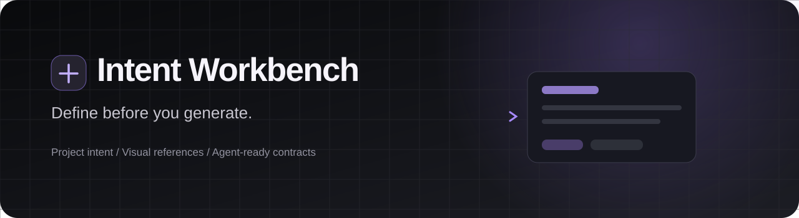
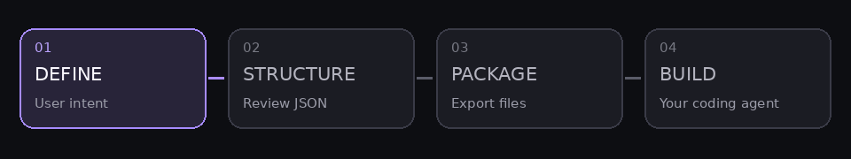
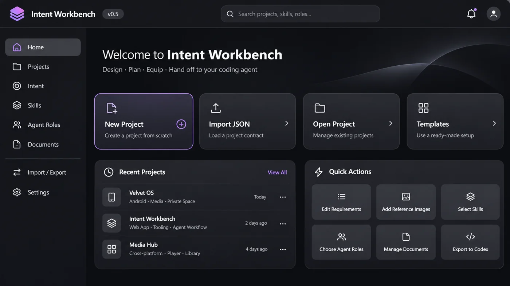
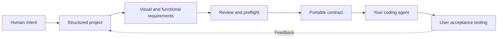

<div align="center" dir="rtl">



<br />

**ابزاری محلی برای مهندسی نیت پروژه در توسعه نرم‌افزار با کمک هوش مصنوعی.**

هدف‌ها، محدودیت‌ها، مراجع بصری، نیازمندی‌ها و معیارهای پذیرش پروژه را به یک **بسته قابل بازبینی و قابل‌انتقال** برای ایجنت‌های کدنویسی تبدیل کنید.

<br />

[🇮🇷 فارسی](README.fa.md) · [🇬🇧 English](README.md)

<br />


[شروع سریع](#-شروع-سریع) · [قابلیت‌ها](#-چه-کارهایی-میتوانید-انجام-دهید) · [گردش کار](#-چطور-کار-میکند) · [JSON و تصاویر](#-json-و-مراجع-بصری) · [محدودیت‌ها](#-محدودیتهای-فعلی)

</div>

---

<div dir="rtl">

## ایده اصلی

**دیگر از ایجنت کدنویس نخواهید حدس بزند منظورتان چه بوده است.**

در بسیاری از فرایندهای کدنویسی مبتنی بر هوش مصنوعی، کشف نیازمندی‌ها، طراحی محصول، معماری و پیاده‌سازی همگی در یک گفت‌وگو مخلوط می‌شوند. Intent Workbench مرحله **تعریف کار** را از **اجرای کار** جدا می‌کند:

- **انسان** درباره محدوده پروژه، اولویت‌ها، میزان وفاداری به مراجع و تأیید نهایی تصمیم می‌گیرد.
- **Workbench** به ساختاردهی و بسته‌بندی این تصمیم‌ها کمک می‌کند.
- **ایجنت کدنویس** قرارداد توافق‌شده را در محیط خودش پیاده‌سازی می‌کند.

**این پروژه Harness ایجنت، محیط توسعه (IDE)، مسیریاب مدل‌های زبانی یا موتور اجرای کد نیست.** Intent Workbench ایجنت شما را اجرا نمی‌کند و بودجه توکن آن را مدیریت نمی‌کند؛ بلکه فایل‌هایی تولید می‌کند که می‌توانید آن‌ها را بررسی، ویرایش، خروجی‌گیری و به ابزار دلخواهتان تحویل دهید.

</div>

<div align="center">
  
</div>

<div dir="rtl">

## ✨ چه کارهایی می‌توانید انجام دهید؟

| بخش | قابلیت‌ها |
|:--|:--|
| **نیت پروژه (Project Intent)** | تعریف محصول، مخاطبان، محدوده، موارد خارج از محدوده، محدودیت‌های فنی و نیازمندی‌های قطعی. |
| **نیازمندی‌ها (Requirements)** | مدیریت نیازمندی‌های قابل ردیابی، اولویت‌ها، وابستگی‌ها، سیاست تغییر و معیارهای پذیرش. |
| **نیت بصری (Visual Intent)** | تعریف صفحه‌ها و اتصال مراجع تصویری به نیازمندی‌های مشخص؛ تمایز بین الهام، مرجع ساختاری و مرجع الزام‌آور. |
| **مسیرهای کاربر (User Journeys)** | مستندسازی سناریوهای پذیرش سرتاسری و جداکردن تست‌های برنامه‌ریزی‌شده از نتایج واقعاً اجراشده. |
| **بانک Skill و Role** | انتخاب Skillهای مبتنی بر دستورالعمل و شرح نقش‌های تخصصی؛ بررسی پیشنهادها پیش از قراردادن آن‌ها در بسته تحویل به ایجنت. |
| **برنامه‌ریز اجرا (Execution Planner)** | ایجاد و ویرایش وظایف، وابستگی‌ها، وضعیت‌ها، مسئولیت‌ها و شواهد؛ تبادل دستی تسک‌بورد با ایجنت کدنویس. |
| **مدیریت اسناد (Document Manager)** | نگهداری راهنمای اختصاصی ایجنت و اسناد مکمل پروژه. |
| **بازبینی اولیه و خروجی (Preflight & Export)** | شناسایی فیلدهای ناقص یا ناسازگار قرارداد و خروجی‌گرفتن از بسته قابل‌انتقال پروژه. |
| **ورود/خروج JSON** | پرکردن دستی پروژه یا دریافت JSON ساختاریافته از مدل دیگر و سپس بررسی اطلاعات در محیط محلی. |

> **تأیید کاربر مهم است:** پیشنهادهای تولیدشده توسط هوش مصنوعی و داده‌های واردشده، خودبه‌خود نیازمندی تأییدشده محسوب نمی‌شوند. پیش از تحویل به ایجنت، تصمیم‌های مهم را تأیید کنید.

## 🖥️ پیش‌نمایش رابط کاربری

</div>

<div align="center">
  
  <br />
  <sub>این تصویر نمایانگر مسیر طراحی است، نه اسکرین‌شات تأییدشده از برنامه در حال اجرا. پیش از انتشار نسخه پایدار 1.0 بهتر است آن را با تصویر واقعی جایگزین کنیم.</sub>
</div>

<div dir="rtl">

## 🚀 شروع سریع

**پیش‌نیازها:** پایتون 3.10 یا بالاتر و یک مرورگر وب مدرن. سرور محلی اصلی فقط از کتابخانه استاندارد پایتون استفاده می‌کند.

</div>

```bash
# دریافت ریپازیتوری
git clone https://github.com/AlamorNetwork/intent-workbench.git
cd intent-workbench

python server.py
```

<div dir="rtl">

سپس آدرس **http://127.0.0.1:8787** را در مرورگر باز کنید.

در ویندوز می‌توانید فایل `start-windows.bat` را نیز از پوشه اصلی پروژه اجرا کنید.

> محلی‌بودن به معنی ایمن‌بودن برای شبکه عمومی نیست. سرور توسعه را روی سیستم خودتان نگه دارید و مستقیماً در اینترنت در دسترس قرار ندهید.

### اجرای تست‌ها

</div>

```bash
python -m unittest discover -s tests -v
```

<div dir="rtl">

نسخه سورسی که این README بر اساس آن آماده شده است، **۳۲ تست واحد** را در محیط بسته‌بندی با موفقیت گذراند. **تست تعاملی کامل مرورگر، اعتبارسنجی روی دستگاه‌های مختلف و فرایند نصب توسط اشخاص ثالث** در این مرحله به‌صورت مستقل تأیید نشده‌اند.

## 🧭 چطور کار می‌کند؟

1. **تعریف (Define)** — هدف، محدوده، نیازمندی‌ها و معیارهای پذیرش پروژه را بنویسید.
2. **مستندسازی مرجع (Ground)** — مراجع طراحی را به صفحه‌ها و نیازمندی‌ها متصل کنید؛ مشخص کنید چه چیزی باید حفظ شود و چه چیزی می‌تواند تغییر کند.
3. **برنامه‌ریزی (Plan)** — Skillها و شرح نقش‌های مناسب را انتخاب و کار را به وظایف قابل راستی‌آزمایی تقسیم کنید.
4. **بازبینی (Review)** — Preflight را اجرا کنید، پرسش‌های باز را بررسی و قرارداد را تأیید کنید.
5. **بسته‌بندی (Package)** — اسناد و خروجی‌های ماشین‌خوان را برای ایجنت کدنویس تولید کنید.
6. **راستی‌آزمایی (Verify)** — خروجی ایجنت را با قرارداد تأییدشده مقایسه و شواهد تست را ثبت کنید.

</div>



<div dir="rtl">

### نمونه بسته تحویل قرارداد

یک خروجی پروژه می‌تواند شامل فایل‌های زیر باشد:

</div>

```text
project-handoff/
├── AGENTS.md
├── PROJECT_INTENT.md
├── REQUIREMENTS.md
├── ACCEPTANCE_TESTS.md
├── VISUAL_INTENT.md
├── USER_JOURNEYS.md
├── EXECUTION_PLAN.md
├── TASK_BOARD.json
├── CONTRACT_AUDIT.md
├── .agents/
│   └── skills/
│       └── project-intent/
│           └── SKILL.md
└── references/
    └── ...
```

<div dir="rtl">

نام دقیق فایل‌ها و محتوای آن‌ها به پروژه خروجی‌گرفته‌شده و منابع انتخابی بستگی دارد. این مثال الگوی تحویل را نشان می‌دهد، نه تضمین سازگاری API با همه ایجنت‌های کدنویسی.

## تولید JSON پروژه با هر مدل هوش مصنوعی

1. از مسیر ورود JSON در برنامه، **دریافت بسته راهنمای مدل + بانک Skill/Role** را انتخاب کنید. بسته از مسیر `/api/extraction-kit` برنامهٔ محلی نیز در دسترس است.
2. بسته و پرامپت زیر را همراه گفت‌وگو، فایل‌ها و تصاویر موردنظر به مدل انتخابی خود بدهید.
3. پاسخ را به صورت فایل JSON با UTF-8 ذخیره یا در پنجرهٔ ورود JSON جای‌گذاری کنید. پیش‌نویس را بازبینی کنید، Preflight را اجرا کنید و فقط پس از بررسی انسانی قرارداد را تأیید کنید.

```text
شما مهندس نیازمندی و گردآورندهٔ زمینه هستید. گفت‌وگو، تصاویر و اسناد در دسترس را تحلیل کنید. کد ننویسید.

۱. فقط یک سند JSON معتبر مطابق template بستهٔ استخراج برگردانید. مقدار schema_version برابر "1.6" باشد. توضیح، Markdown یا حصار کد برنگردانید.
۲. همهٔ نیازمندی‌های تأییدشده و منشأ دقیق آن‌ها را استخراج کنید. ایده‌های تأییدنشده را مشخص کنید و برای موارد نامطمئن از approval به جای locked استفاده کنید.
۳. توضیحات available_skills و available_roles را بخوانید. فقط موارد واقعاً مفید را با شناسه و فیلدهای دقیق بسته در bank.skills و bank.roles قرار دهید. این موارد پیشنهادهایی برای بررسی انسانی‌اند. اگر مورد مناسبی نیست آرایه را خالی بگذارید و در notes توضیح دهید. شناسه نسازید.
۴. برای هر صفحه یا جریان واقعی، screens را با نام، هدف، چیدمان، اجزا، تعامل‌ها، حالت‌ها، پاسخ‌گویی، توکن‌ها، پذیرش، نقش و related_requirements کامل کنید. برای سبک نامعلوم از NOT_SPECIFIED استفاده کنید و تأیید یا صفحهٔ فرضی نسازید.
۵. برای مسیرهای مهم، journeys را با نام، پیش‌شرط، مراحل شماره‌دار، نتیجهٔ مورد انتظار و پیوند نیازمندی بنویسید. بدون شواهد صریح اجرای تست، actual را خالی و status را not_run بگذارید. نتیجهٔ قبولی یا تست صوری نسازید.
۶. مراجع و پیوندهای reference_ids و related_requirements را حفظ کنید. تصویر در دسترس‌نبوده را mentioned_only یا external_url_only ثبت کنید و وضعیت attached جعل نکنید.
۷. تسک‌ها و وابستگی‌ها را بر اساس شواهد ثبت کنید. بدون شواهد تست وضعیت done ندهید.
۸. همهٔ کلیدهای قالب را وارد کنید. JSON بدون کامای انتهایی و قابل تجزیه باشد. NOT_SPECIFIED فقط در فیلد متنی مناسب استفاده شود. نوع آرایه‌ها و اشیا را حفظ کنید و برای موارد فاقد مدرک مجموعهٔ خالی بگذارید. تصمیم‌های باز را در conflicts شرح دهید.
۹. بدون دسترسی به سورس ادعای بررسی مخزن نکنید. تکرار را کم کنید و معیارهای پذیرش قابل سنجش بنویسید. پیشنهادها پیش از تأیید به بازبینی انسانی نیاز دارند.

اکنون JSON کامل را برگردانید.
```

نمونهٔ حداقلی Schema 1.6. موارد واقعی را با قالب بسته بر اساس شواهد تکمیل کنید.

```json
{"schema_version":"1.6","project":{"title":"Example","summary":"","audience":"","goals":[],"non_goals":[],"technical":"","constraints":[]},"requirements":[],"references":[],"screens":[],"journeys":[],"tasks":[],"design_system":"","architecture":"","workflow":"","conflicts":"","notes":"","bank":{"skills":[],"roles":[],"documents":{}}}
```

## ابزارهای قرارداد

ردیابی نیازمندی‌ها پیوندها و کمبودهای مستندات را نشان می‌دهد. از تاریخچه برای مقایسه و بازیابی نسخه‌ها و از پروفایل‌های تحویل برای پیش‌نمایش بستهٔ Codex، Claude Code یا Generic استفاده کنید. نتایج تست را در بخش شواهد پذیرش وارد و گزارش کنید. ارزیابی AI اختیاری است و به تنظیم ارائه‌دهندهٔ محلی و تأیید هر ارسال نیاز دارد.

[راهنمای مهاجرت، تنظیم ارائه‌دهنده و قالب شواهد](docs/CONTRACT_TOOLS.md)

## 🧩 JSON و مراجع بصری

برنامه از ورود و خروج JSON پروژه پشتیبانی می‌کند و یک **AI Extraction Kit** شامل قالب و اطلاعات انتخاب‌شده درباره Skillها و Roleها برای مدل تحلیل‌گر اولیه در اختیار می‌گذارد.

دو مسیر برای ایجاد پروژه وجود دارد:

- **دستی:** فیلدهای پروژه را پر کنید، نیازمندی‌ها را ویرایش و تصاویر را داخل برنامه ضمیمه کنید.
- **با کمک مدل:** بسته استخراج را به مدلی بدهید که با پروژه آشناست، JSON خروجی آن را وارد کنید و سپس نیازمندی‌ها، نقش‌ها، صفحه‌ها و مسیرهای کاربر را بازبینی کنید.

تصاویر مرجع می‌توانند به نیازمندی‌ها متصل شوند. برای خروجی JSON قابل‌انتقال، داده‌های تصویر ممکن است در فیلد پشتیبانی‌شده تصویر به‌صورت جاسازی‌شده قرار گیرند. **URL خارجی با فایل تصویری ضمیمه‌شده یکسان نیست**؛ بررسی کنید که بسته تحویل به ایجنت واقعاً حاوی فایل‌های لازم باشد.

JSON پروژه از Schema نسخه‌بندی‌شده استفاده می‌کند. نسخه فعلی سورس، Schema **`1.6`** را خروجی می‌دهد و از ورود نسخه‌های قدیمیِ پشتیبانی‌شده نیز پشتیبانی می‌کند.

## 🎭 Skillها و نقش‌های تخصصی

فایل‌های Skill و شرح نقش‌ها **راهنمایی مخصوص وظیفه** ارائه می‌دهند، نه سطح دسترسی سیستمی اضافی.

- کاتالوگ نقش‌ها را وارد یا تنظیم کنید و فقط نقش‌های مرتبط با پروژه را انتخاب کنید.
- Skillهای مبتنی بر دستورالعملِ انتخاب‌شده را در خروجی پروژه بگنجانید.
- پیش از بازنشر محتوای منابع ثالث، منبع و مجوز استفاده آن‌ها را بررسی کنید.
- انتخاب یک Role به‌تنهایی ساب‌ایجنت واقعی ایجاد نمی‌کند؛ مگر اینکه محیط کدنویسی مقصد چنین قابلیتی داشته باشد و آن را فراخوانی کند.
- اسکریپت‌های ناشناسِ اشخاص ثالث به‌صورت خودکار اجرا نمی‌شوند.

## 🔒 مرزهای طراحی

Intent Workbench عمداً **ابزاری برای آماده‌سازی و مستندسازی** است:

**در محدوده محصول:** نگارش، ارتباط‌دادن مراجع، بازبینی، تولید کنترل‌شده اسناد، تبادل JSON، تحویل دستی به ایجنت و ثبت شواهد.

**خارج از محدوده محصول:** فراخوانی یا نظارت بر مدل‌های کدنویس، اجرای خودکار کد، اندازه‌گیری زنده توکن‌ها، هماهنگ‌سازی ساب‌ایجنت‌ها، تغییر خودکار و بدون نظارت ریپازیتوری، یا ادعای اینکه ایجنت نمی‌تواند دستورالعمل‌ها را نادیده بگیرد.

فایل‌های قرارداد، دستورالعمل‌های سطح پروژه هستند. سلسله‌مراتب واقعی دستورالعمل‌ها و مجوزهای ابزار در محیط ایجنت کدنویس همچنان معتبر است.

## 🧪 کیفیت و اعتماد

- موفقیت Build اثبات‌کننده درستی رفتار یا وفاداری بصری نیست.
- تکمیل یک مورد از چک‌لیست، به‌تنهایی شاهد مستقلِ اجرای تست نیست.
- پیشنهاد واردشده از یک مدل، تصمیم تأییدشده محصول محسوب نمی‌شود.
- URL مرجع، معادل داشتن فایل تصویر محلی نیست.
- Workbench نمی‌تواند تضمین کند که ایجنت همه دستورالعمل‌ها را رعایت می‌کند.

پیش از اعلام تکمیل اپلیکیشن، تست پذیرش واقعی کاربر را انجام دهید. پیش از ارتقای نسخه نصب‌شده یا نوشتن فایل‌های خروجی در ریپازیتوری موجود، از اطلاعات پروژه نسخه پشتیبان بگیرید.

## 📈 بازخورد اولیه از تجربه واقعی

آزمایش‌های اولیه توسعه شامل یک پروژه واقعی اپلیکیشن رسانه‌ای اندروید بوده‌اند. صاحب پروژه گزارش کرده که نیاز به تکرار پرامپت‌ها به‌طور محسوسی کمتر شده و مصرف توکن در مقایسه با شیوه قبلی او **حدود ۷۰٪ کاهش تخمینی** داشته است. این نتیجه **بازخورد تجربی بدون آزمایش کنترل‌شده** است، نه بنچمارک یا تضمین عملکرد محصول.

برای یک مقایسه تکرارپذیر باید وظایف، مدل‌ها، Context اولیه، شیوه حسابداری توکن، زمان و کیفیت خروجی پذیرفته‌شده هم‌تراز باشند.

## 🗺️ نقشه راه (هنوز منتشر نشده)

- [ ] تست‌های رگرسیون سرتاسری مرورگر و ممیزی دسترس‌پذیری
- [ ] اسکرین‌شات‌های تأییدشده و ویدئوهای کوتاه معرفی قابلیت‌ها
- [ ] مستندسازی JSON Schema، خطاهای اعتبارسنجی و نمونه‌های مهاجرت نسخه
- [ ] پوشش بهتر نیازمندی‌ها و شناسایی تناقض‌ها
- [ ] پیش‌نمایش ادغام/ورود پروژه بدون تخریب داده‌های قبلی
- [ ] واردکننده دستی گزارش پذیرش خروجی ایجنت (بدون اتصال به محیط اجرا)
- [ ] آماده‌سازی بسته انتشار، تگ نسخه‌ها، تغییرات نسخه و بررسی امنیتی

## 🤝 مشارکت

پس از انتشار ریپازیتوری، Issueها و Pull Requestها پذیرفته می‌شوند. در گزارش باگ، سیستم‌عامل، نسخه پایتون، مراحل بازتولید و یک نمونه JSON پروژه با **اطلاعات حساس حذف‌شده** را ضمیمه کنید. هیچ‌وقت توکن، رمز، رسانه خصوصی یا فایل‌های شخصیِ بازبینی‌نشده را منتشر نکنید.

پیش از ارسال Pull Request، تست‌ها را اجرا کنید:

</div>

```bash
python -m unittest discover -s tests -v
```

<div dir="rtl">

## 📜 مجوز (License)

**در نسخه‌ای که این README بر اساس آن تهیه شده، مجوز هنوز انتخاب نشده بود.** پیش از آنکه ریپازیتوری را به‌صورت رسمی متن‌باز معرفی کنید، یک فایل `LICENSE` با مجوز مورد تأیید OSI (مثلاً MIT یا Apache-2.0) اضافه کنید و مجوز کاتالوگ‌های نقش، متن Skillهای اشخاص ثالث و فایل‌های تصویری را هم پیش از بازتوزیع بررسی کنید.

## ⚠️ محدودیت‌های فعلی

این نسخه **بتای عمومی** است. تست مرورگر در ویندوز با ارائه‌دهندهٔ آزمایشی اجرا شده است. اجرای CI روی لینوکس و اسکن CodeQL در چک‌لیست انتشار باقی مانده‌اند. خروجی مدل‌ها باید توسط کاربر بازبینی شود و اجرای درست قرارداد توسط ایجنت مقصد تضمین نمی‌شود.

</div>

---

<div align="center" dir="rtl">

**نیت را شفاف کنید؛ پیاده‌سازی را منعطف نگه دارید؛ تصمیم نهایی درباره «انجام‌شدن کار» با انسان است.**

<sub>Intent Workbench · پیش از تولید، تعریف کن.</sub>

[🇬🇧 Read in English](README.md)

</div>
