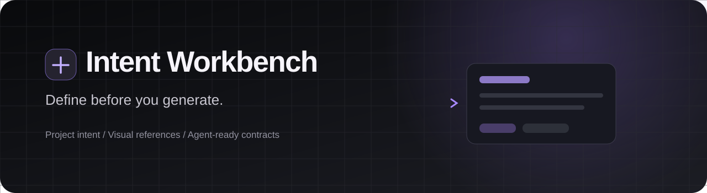
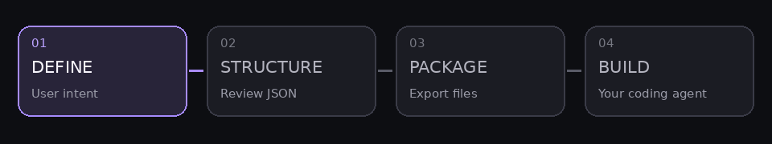
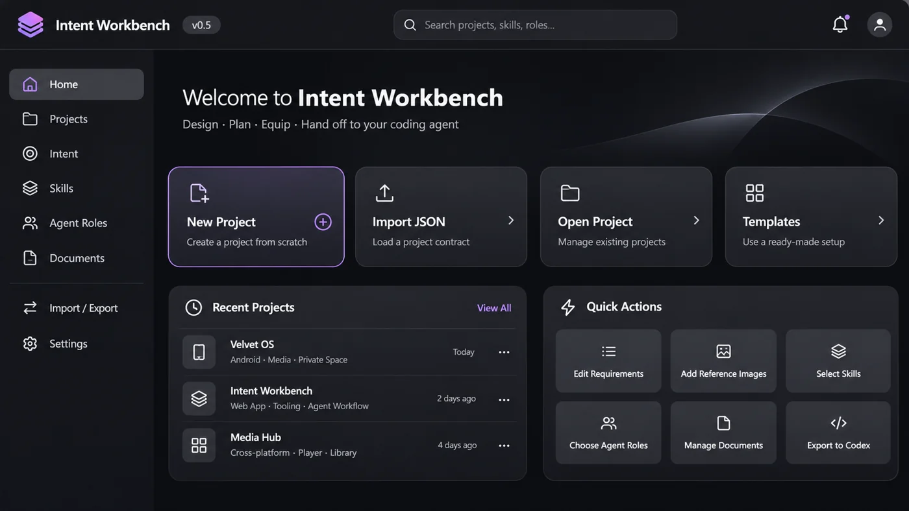
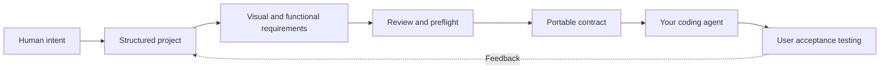

<div align="center">



<br />

**A local-first intent engineering workbench for AI-assisted software development.**

Turn a project's goals, constraints, visual references, requirements, and acceptance criteria into a **reviewable, portable handoff** for coding agents.

<br />


[Quick start](#-quick-start) · [Features](#-what-you-can-do) · [Workflow](#-how-it-works) · [JSON & assets](#-json-and-visual-references) · [Limitations](#-current-limitations)

[🇮🇷 فارسی](README.fa.md) | [🇬🇧 English](README.md)

</div>

---

## The idea

**Stop asking a coding agent to guess what you meant.**

Most AI coding workflows mix requirements discovery, product design, architecture, and implementation in the same conversation. Intent Workbench separates **defining the work** from **doing the work**:

- The **human** owns scope, priorities, reference fidelity, and final approval.
- The **Workbench** helps structure and package those decisions.
- The **coding agent** implements the agreed contract in its own environment.

**This is not an agent harness, IDE, LLM router, or code execution engine.** Intent Workbench does not run your coding agent or manage its token budget. It generates files you can inspect, edit, export, and hand to the tool of your choice.

<div align="center">
  
</div>

## ✨ What you can do

| Workspace | Capabilities |
|:--|:--|
| **Project Intent** | Describe the product, intended audience, scope, non-goals, technical constraints, and fixed requirements. |
| **Requirements** | Manage traceable requirements, priorities, dependencies, change policies, and acceptance criteria. |
| **Visual Intent** | Define screens and link references to individual requirements. Distinguish inspiration from structural or strict references. |
| **User Journeys** | Document end-to-end acceptance scenarios and separate planned tests from executed results. |
| **Skill & Role Bank** | Select instruction-based project Skills and expert-role briefs; review suggestions before including them in an agent handoff. |
| **Execution Planner** | Create and edit tasks, dependencies, statuses, ownership, and evidence; exchange a task board with the coding agent manually. |
| **Document Manager** | Maintain project-level agent guidance and companion documents. |
| **Preflight & Export** | Find missing or inconsistent contract fields, then export a portable project package. |
| **JSON import/export** | Fill projects manually or obtain structured JSON from another model, then review everything locally. |

> **Approval matters:** AI-produced suggestions and imported data are not automatically approved requirements. Confirm critical choices before handoff.

## 🖥️ Interface preview

<div align="center">
  
  <br />
  <sub>Design concept for the charcoal workspace.</sub>
</div>

## 🚀 Quick start

**Requirements:** Python 3.10+ and a modern web browser. The core local server uses the Python standard library.

```bash
# Clone your repository once you publish it
# git clone https://github.com/AlamorNetwork/intent-workbench.git
# cd intent-workbench

python server.py
```

Open **http://127.0.0.1:8787**.

On Windows, you can also run `start-windows.bat` from the project root.

> Local-first does not mean public-network hardened. Keep the development server on your machine and do not expose it directly to the internet.

### Run the tests

```bash
python -m unittest discover -s tests -v
```

The source snapshot used to prepare this README passed **32 unit tests** in the packaging environment. Browser-wide interactive testing, device-specific validation, and third-party installation flows have **not** been independently verified here.

## 🧭 How it works

1. **Define** — Write the project goal, boundaries, requirements, and acceptance criteria.
2. **Ground** — Attach design references to screens and requirements; declare what must be preserved and what may change.
3. **Plan** — Choose appropriate Skills/role briefs and organize work into verifiable tasks.
4. **Review** — Run preflight, inspect open questions, and approve the contract.
5. **Package** — Export documents and machine-readable artifacts for a coding agent.
6. **Verify** — Test the agent's result against the approved contract and record your evidence.



### Contract handoff example

A project export can include documents such as:

```text
project-handoff/
├── AGENTS.md
├── PROJECT_INTENT.md
├── REQUIREMENTS.md
├── ACCEPTANCE_TESTS.md
├── VISUAL_INTENT.md
├── USER_JOURNEYS.md
├── EXECUTION_PLAN.md
├── TASK_BOARD.json
├── CONTRACT_AUDIT.md
├── .agents/
│   └── skills/
│       └── project-intent/
│           └── SKILL.md
└── references/
    └── ...
```

Exact filenames and contents depend on the exported project and selected resources; the example illustrates the handoff pattern, not an API compatibility guarantee for every coding agent.

## Generate your Project JSON with any AI model

1. Run `python server.py`, open the local address it prints, and use **Import JSON → Download AI Extraction Kit**. You can also retrieve `/api/extraction-kit` from the running app.
2. Give the kit and the prompt below to your chosen AI model with the conversation, files, and images you intend it to use.
3. Save the response as UTF-8 JSON or paste it into **Import JSON**. Review the import as a draft, run Preflight, and approve only after a human review.

```text
# INTENT WORKBENCH v0.9 — AI EXTRACTION CONTRACT

You are a requirements engineer and context compiler. Analyze the conversation, accessible images and documents. DO NOT write code.

1. Return ONLY one valid JSON document matching `template` of the supplied extraction kit. Use schema_version 1.6. Do not include commentary or Markdown fences.
2. Extract all confirmed requirements and exact source provenance. Keep unapproved ideas flagged as such, and use `approval` rather than `locked` for uncertain requirements.
3. The extraction kit contains `available_skills` and `available_roles`. Examine their descriptions, then put ONLY genuinely useful entries into `bank.skills` and `bank.roles` using their exact IDs and fields. Those selections are proposals pending human review, not installed execution agents. If no role fits, leave empty and explain in notes. Never invent a role ID.
4. Produce detailed `screens`: for EACH real screen or distinct flow described by evidence, include name, purpose, layout, components, interactions, states, responsive, tokens, acceptance, role, related_requirements. If exact styling is unknown use NOT_SPECIFIED; do not claim it is approved. Do not create placeholder empty screens.
5. Produce realistic `journeys` for critical end-to-end user actions with name, preconditions, numbered steps, expected outcome and requirement links. Set `actual` to empty and `status` to `not_run` unless verified user-test evidence explicitly exists. Do not fabricate pass results. Do not leave six fake blank tests.
6. Preserve image references and `reference_ids`; images not directly available must be `mentioned_only` or `external_url_only`, not `attached`.
7. Include implementation tasks and dependencies where grounded, but do not mark tasks `done` without test evidence.
8. All required JSON keys from the template must be present. JSON must parse, with no trailing commas. If unknown, leave exact value `NOT_SPECIFIED` and explain open decisions in `conflicts`.
9. Never assert that a repo was inspected if source code is unavailable. Minimize duplication and keep acceptance criteria measurable.

Output the full JSON now.

Use NOT_SPECIFIED only in appropriate text fields. Keep arrays and objects correctly typed, using empty collections when no entries are supported. Preserve stable IDs and reciprocal reference links. A human must review any proposed decisions before approval.
```

Minimal Schema 1.6 example. Add real entities from your evidence using the kit template.

```json
{"schema_version":"1.6","project":{"title":"Example","summary":"","audience":"","goals":[],"non_goals":[],"technical":"","constraints":[]},"requirements":[],"references":[],"screens":[],"journeys":[],"tasks":[],"design_system":"","architecture":"","workflow":"","conflicts":"","notes":"","bank":{"skills":[],"roles":[],"documents":{}}}
```

## Contract tools

Use **Traceability** to find documentation gaps, **History** to compare or restore snapshots, and **Handoff Profiles** to preview a Codex, Claude Code, or generic ZIP. **Acceptance Evidence** imports and reports test results locally. **AI Review** is optional and requires a local provider configuration and consent on each preview.

See the [migration, provider setup and evidence format guide](docs/CONTRACT_TOOLS.md).

## 🧩 JSON and visual references

The application supports project JSON import/export and provides an **AI Extraction Kit** with a template and curated Skill/Role information for the upstream model.

Two supported creation paths:

- **Manual:** Fill in project fields, edit requirements, and attach images inside the app.
- **Assisted:** Give the extraction kit to a model familiar with the project, import its JSON response, then review the proposed requirements, roles, screens, and journeys.

Reference images can be attached to requirements. For portable JSON exports, image bytes may be embedded in the supported image-data field. External URLs are **not the same** as attached files; verify that the agent handoff actually contains the assets you need.

Project JSON uses a versioned schema. The current source snapshot exports schema **`1.6`** and can import earlier supported versions.

## 🎭 Skills and expert roles

Skill files and role briefs provide **task-specific guidance**, not extra system authority.

- Import or curate a role catalog; choose only roles relevant to the project.
- Include selected instruction-based Skills in an exported project.
- Keep third-party sources and licenses in mind before sharing their content.
- Selecting a role does **not** create a real subagent unless the target coding environment supports and invokes one.
- Unknown third-party scripts are **not** automatically executed.

## 🔒 Design boundaries

Intent Workbench is intentionally **a preparation and documentation tool**:

**In scope:** authoring, reference linking, review, controlled document generation, JSON interchange, manual agent handoff, and evidence tracking.

**Out of scope:** invoking or supervising coding models, automatic code execution, live token metering, orchestration of subagents, unattended repository mutation, or claiming that instructions cannot be ignored by an agent.

Contract files are project-level instructions. A coding agent's actual instruction hierarchy and tool permissions still apply.

## 🧪 Quality and trust

- A successful build does not prove correct behavior or visual fidelity.
- A completed checklist entry is not independent test evidence.
- An imported model suggestion is not an approved product decision.
- A reference URL is not an available local image file.
- The Workbench cannot guarantee that a coding agent follows every instruction.

Use a real user-acceptance pass before marking an application complete. Back up project data before upgrading installations or writing exported files into an existing repository.

## 📈 Early field feedback

The initial development experiments included a real Android media application project. The owner reported substantially less repetitive prompting and an **estimated ~70% reduction in token use** compared with their prior workflow. This is **anecdotal, uncontrolled feedback**, not a benchmark or product performance guarantee.

A reproducible comparison would need matched tasks, models, starting contexts, token accounting, time, and accepted output quality.

## 🗺️ Roadmap (not shipped)

- [ ] End-to-end browser regression tests and accessibility audit
- [ ] Verified screenshots and short feature walkthroughs
- [ ] JSON schema documentation, validation errors, and migration fixtures
- [ ] Better requirement coverage and contradiction detection
- [ ] Non-destructive project import/merge previews
- [ ] Agent-result acceptance report importer (manual; no runtime integration)
- [ ] Release packaging, version tags, changelog, and security review

## 🤝 Contributing

Issues and pull requests are welcome after the repository is published. For bug reports, include your OS, Python version, steps to reproduce, and a **redacted** sample project JSON. Never attach tokens, passwords, private media, or unreviewed personal project files.

Before opening a PR, run:

```bash
python -m unittest discover -s tests -v
```

## 📜 License

**Not yet selected.** Before calling this repository open source, add a `LICENSE` file with an OSI-approved license you choose (for example MIT or Apache-2.0), and check the licenses of third-party role catalogs, skill text, and assets before redistribution.

---

<div align="center">

**Make intent explicit. Keep implementation flexible. Let the human decide what “done” means.**

<sub>Intent Workbench · Define before you generate.</sub>

</div>
